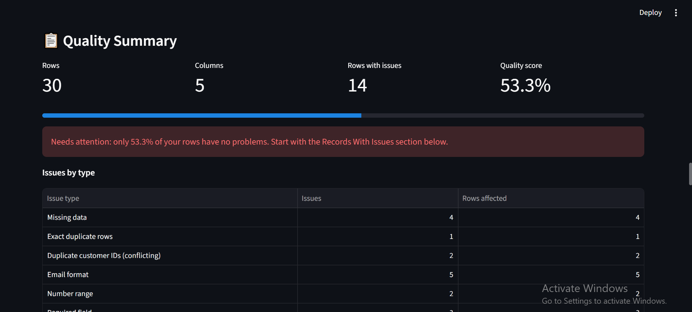
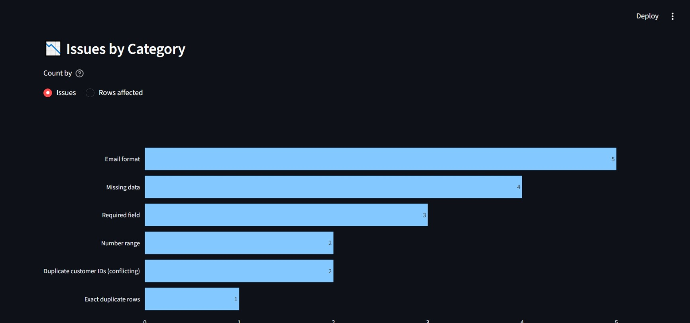

# DataCheck: Data Quality Dashboard

A Streamlit app that checks a CSV or Excel file for data-quality problems, gives it a quality score, and lets you download a cleaned copy and a separate issue report. Your original data is never changed.

**Live demo:** <PASTE YOUR STREAMLIT URL HERE AFTER DAY 13>



## What it does

- **Upload** a CSV or Excel (.xlsx) file, or load the built-in sample data. Empty, unreadable and unsupported files get a clear message instead of a crash.
- **Missing data:** counts blank cells per column and lists the affected rows. Cells containing only spaces count as blank.
- **Duplicates:** finds exact duplicate rows, and separately finds repeated customer IDs. It tells apart a repeated ID with identical details from one with conflicting details.
- **Field validation:** required fields, email format and number range. Each rule can be switched on or off, and only uses columns that exist in your file.
- **Quality score:** `rows with no issue / total rows x 100`. A row counts once, however many problems it has.
- **Charts and filters:** a chart of issues by category, and a table of only the rows that have problems, with the reason for each.
- **Safe cleaning:** remove exact duplicates, fill blank cells (median, mean, most common value or a custom value) or remove rows that still have blanks. Cleaning always works on a copy, and a "what changed" list shows exactly what was done.
- **Downloads:** cleaned data (CSV or Excel) and a separate Excel issue report with a summary sheet and one sheet per problem type.



## Row numbers

Every table uses **File Row**, the row number you would see in Excel (the header is row 1, so the first record is row 2). You can jump straight to a problem in your own file.

## How the quality score works

A row is flagged if it:

1. has a blank cell,
2. is an extra copy of an identical row (the first copy is not flagged),
3. shares a customer ID with a row that has different details (both rows are flagged, because the tool cannot tell which one is correct), or
4. fails a validation rule that is switched on.

`score = (total rows - flagged rows) / total rows x 100`

## Run it locally

Requires Python 3.10 or newer.

```bash
git clone https://github.com/zealnewar1/datacheck-data-quality-dashboard.git
cd datacheck-data-quality-dashboard
python -m venv .venv
.venv\Scripts\activate          # Windows
# source .venv/bin/activate     # macOS / Linux
pip install -r requirements.txt
python -m streamlit run app.py
```

## Run the tests

```bash
python -m pytest -v
```
“The project has 115 automated tests.” If you add tests later, update the number or leave it out.
The checks and cleaning logic are plain pandas functions with no Streamlit code, so they are tested directly. The tests cover missing-value detection, duplicate detection, email and range validation, the quality score arithmetic, cleaning (including that the original data is left unchanged), the issue report, and empty or invalid input files.

## Project structure

| File | Purpose |
|---|---|
| `app.py` | The Streamlit interface |
| `file_loading.py` | Reads CSV and Excel files and handles bad input |
| `data_quality.py` | Missing data, duplicate and validation checks |
| `quality_summary.py` | Issue counts, quality score, flagged records |
| `cleaning.py` | Safe cleaning options that work on a copy |
| `reports.py` | Builds the Excel issue report |
| `sample_data.py` | Built-in sample data |
| `ui_helpers.py` | Small display helpers |
| `test_*.py` | Automated tests for each module |
| `customers.csv` | Sample file with deliberate problems |

## Limitations

- Email validation checks the **format** only. It cannot confirm that an address exists.
- Only **exact** duplicates are detected. Near-matches such as "Jon" and "John" are not.
- The first row of the file is treated as the header.
- Validation rules are not saved between sessions.
- Very large files are limited by the memory of the machine running the app.

## Built with

Python, pandas, Streamlit, Plotly, openpyxl, pytest.
